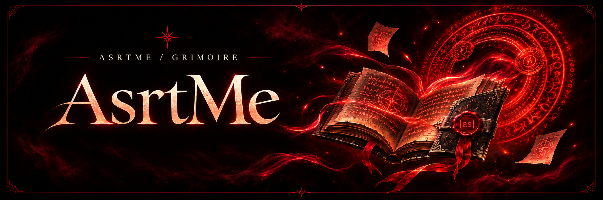
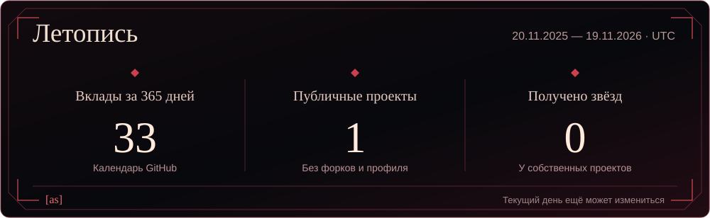
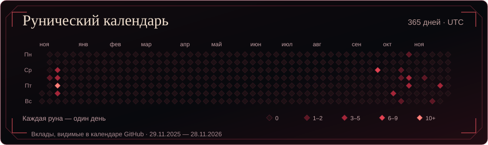

  

  
  &nbsp;
  

## Привет, я Артём

Игры, ИИ и эксперименты. Люблю разбираться, как всё устроено, и пробовать свои идеи в деле.

<picture>
  <source media="(max-width: 600px)" srcset="./assets/stats-mobile.svg">
  
</picture>

<strong>✦ [as] Снять печать · открыть гримуар</strong>

### На страницах гримуара

- **Игровые системы** — механики, баланс и собственные игровые идеи.
- **ИИ и автоматизация** — эксперименты с моделями и полезными инструментами.
- **Творческие проекты** — визуал, новые форматы и необычные задумки.

### Руническая летопись

<picture>
  <source media="(max-width: 600px)" srcset="./assets/activity-mobile.svg">
  
</picture>

Данные из публично видимого календаря GitHub. В число проектов и их звёзд входят собственные публичные репозитории без форков и репозитория этого профиля.

---

*Не каждое заклинание срабатывает с первого раза.*

